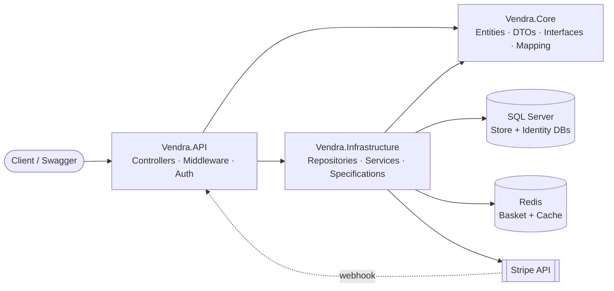

# 🛍️ Vendra — E-Commerce REST API

A full-featured e-commerce backend built with **ASP.NET Core 8**. It covers the complete shopping journey — product catalog, Redis-backed basket, JWT authentication with roles, order management, and **Stripe** card payments confirmed through **signature-verified webhooks**.


<!-- 📸 Add a Swagger UI screenshot here:   -->

---

## ⭐ Highlights

**Architecture & patterns**
- 🧱 **Layered solution** (`API` / `Core` / `Infrastructure`) with abstractions (`IGenericRepo`, `ISpecification`, `IUnitOfWorkRepo`) defined in Core and implemented in Infrastructure.
- 🔍 **Specification pattern** over a **Generic Repository** and **Unit of Work** — filtering, includes, sorting and paging live in small, named, reusable classes (`ProductWithTypeAndBrand`, `OrderWithItemAndDeliveryMethodSpec`). Controllers contain no LINQ query logic.
- 📦 **Order aggregate** (`Order` → `OrderItem` → `ProductItemOrder`) that **snapshots product name, image and price at purchase time**, so order history stays correct even if the catalog changes later.
- 🗄️ **Two separate databases and DbContexts** (store data vs. ASP.NET Identity), each with its own migrations.

**Payments & integrity**
- 💳 **Stripe PaymentIntents** with order state driven by **webhook events verified via Stripe's signature** — the client can never claim "I paid".
- 🛡️ **Server-side pricing:** prices are re-read from the database when the basket is updated, when the PaymentIntent is created, and when the order is built — client-sent prices are never trusted.

**Performance**
- ⚡ **Redis basket** with a 30-day TTL.
- 🚀 **Custom `[CachedResponse(seconds)]` action filter** backed by Redis: cache keys are built from the request path plus sorted query-string parameters, so equivalent requests share one cache entry.
- 📄 **Server-side pagination** with a capped page size, plus brand/type filters, name search and price sorting.

**Security & API quality**
- 🔐 **ASP.NET Core Identity + JWT Bearer** with role-based authorization (`Admin`, `Customer`) and protected admin endpoints.
- 🧯 **Global exception middleware** — full details in Development, a safe generic message in Production.
- 📐 **Uniform response envelope** (`statusCode`, `isSuccess`, `message`, `data`, `errors`) and a custom model-validation response, so every endpoint behaves the same for front-end clients.
- ✅ **Custom validation attribute** (`RequiredIf`) — e.g. an image is mandatory when creating a product but optional when editing.
- 🔑 API keys, JWT key and connection strings are managed with **.NET User Secrets**, not stored in `appsettings.json`.

**Developer experience**
- 🖼️ **Image pipeline:** upload validation (type + size), unique file names, automatic **thumbnail generation** (ImageSharp) and cleanup of old files on update/delete; **AutoMapper** URL resolvers return absolute image URLs.
- 🌱 **Automatic migrations and data seeding** on startup (brands, types, 18 products, delivery methods, roles, admin).
- 📚 **Swagger UI**, typed `ProducesResponseType` annotations on catalog endpoints, a `.http` file, and a ready-to-import **Postman collection** with an environment file.

---

## 🧱 Architecture



```
Vendra.sln
├── Vendra.API              # Controllers, middleware, DI & JWT setup, Swagger
├── Vendra.Core             # Entities, DTOs, interfaces, AutoMapper profiles, EF configs, seeds
└── Vendra.Infrastructure   # Generic repo, Unit of Work, specifications, order/payment/basket/image services

docs/                       # Postman collection and environment
```

---

## 🔄 Checkout flow

```
1. POST  Basket/Update-Basket                 → basket saved in Redis (prices refreshed from DB)
2. GET   Order/Get-Delivery_Methods           → choose shipping option
3. POST  Payments/Create-Update-Payment-intent/{basketId}
                                              → Stripe PaymentIntent created/updated, clientSecret returned
4. POST  Order/Create-Order                   → order persisted (status: Pending)
5. Stripe → POST Payments/webhook             → status becomes PaymentReceived or PaymentFailed
```

---

## 📚 API Overview

Interactive docs are available through **Swagger UI** when running in Development.

### Account
| Method | Endpoint | Auth |
|--------|----------|------|
| POST | `/api/Account/Register` | Public |
| POST | `/api/Account/Login` | Public |
| GET  | `/api/Account/EmailExist?email=` | Public |
| GET  | `/api/Account/GetCurrnetUser` | 🔒 User |
| GET / PUT | `/api/Account/Get-Address` · `/Update-Address` | 🔒 User |

### Products
| Method | Endpoint | Auth |
|--------|----------|------|
| GET | `/api/Product/Get-All-Products?sort=&brandId=&typeId=&search=&pageIndex=&take=` | Public (cached) |
| GET | `/api/Product/Get-Product/{id}` | Public (cached) |
| GET | `/api/Product/Brands` · `/api/Product/Types` | Public (cached) |

### Basket
| Method | Endpoint | Auth |
|--------|----------|------|
| GET | `/api/Basket/Get-Basket/{id}` | Public |
| POST | `/api/Basket/Update-Basket` | Public |
| DELETE | `/api/Basket/Delete-Basket?id=` | Public |

### Orders & Payments
| Method | Endpoint | Auth |
|--------|----------|------|
| POST | `/api/Order/Create-Order` | 🔒 User |
| GET | `/api/Order/Get-Orders` · `/Get-Order-By-Id?orderId=` · `/Get-Delivery_Methods` | 🔒 User |
| POST | `/api/Payments/Create-Update-Payment-intent/{basketId}` | 🔒 User |
| POST | `/api/Payments/webhook` | Stripe signature |

### Admin
| Method | Endpoint | Auth |
|--------|----------|------|
| POST | `/api/ProductsAdmin/Add-Product` | 🛡️ Admin |
| PUT | `/api/ProductsAdmin/Edit-Product/{id}` | 🛡️ Admin |
| DELETE | `/api/ProductsAdmin/Delete-Product/{id}` | 🛡️ Admin |
| POST | `/api/admin/users/create-admin` | 🛡️ Admin |
| GET | `/api/admin/users/get-all-users` | 🛡️ Admin |

---

## 🧰 Tech Stack

| Concern | Technology |
|---------|-----------|
| Framework | ASP.NET Core 8 Web API |
| ORM / Database | Entity Framework Core 8 · SQL Server |
| Cache / Basket | Redis (StackExchange.Redis) |
| Auth | ASP.NET Core Identity · JWT Bearer |
| Payments | Stripe.net |
| Mapping | AutoMapper |
| Images | SixLabors ImageSharp |
| API docs & testing | Swagger / Swashbuckle · Postman |

---

## 🚀 Getting Started

### Prerequisites
- [.NET 8 SDK](https://dotnet.microsoft.com/download/dotnet/8.0)
- SQL Server (Express is fine)
- Redis — e.g. `docker run -d -p 6379:6379 redis`
- A free [Stripe](https://dashboard.stripe.com/register) account (test mode) and, optionally, the [Stripe CLI](https://stripe.com/docs/stripe-cli)

### 1. Clone
```bash
git clone https://github.com/youssefzsc321-debug/Vendra.git
cd Vendra
```

### 2. Configure secrets
```bash
cd Vendra.API

dotnet user-secrets set "ConnectionStrings:DefaultConnection"  "Server=.\SQLEXPRESS;Database=Vendra;Trusted_Connection=True;MultipleActiveResultSets=true;TrustServerCertificate=True"
dotnet user-secrets set "ConnectionStrings:IdentityConnection" "Server=.\SQLEXPRESS;Database=VendraIdentity;Trusted_Connection=True;MultipleActiveResultSets=true;TrustServerCertificate=True"

dotnet user-secrets set "JWT:Key" "<a-random-string-of-at-least-32-characters>"

dotnet user-secrets set "StripeSettings:Secretkey" "sk_test_..."
dotnet user-secrets set "StripeSettings:WhSecret"  "whsec_..."
```
> The Redis connection defaults to `localhost` (see `appsettings.json`).

### 3. Run
```bash
cd ..
dotnet run --project Vendra.API --launch-profile https
```
On first start the app **applies migrations automatically** and **seeds** brands, product types, products, delivery methods, roles and an initial admin user.

Open **https://localhost:7083/swagger**

### 4. Try payments locally (optional)
```bash
stripe listen --forward-to https://localhost:7083/api/Payments/webhook --skip-verify
```
Copy the `whsec_...` it prints into the `StripeSettings:WhSecret` secret and pay with the Stripe test card `4242 4242 4242 4242` (any future expiry, any CVC).

### Authenticating in Swagger
1. `POST /api/Account/Login` and copy the `token` from the response.
2. Click **Authorize** in Swagger UI and paste the token, or send it as `Authorization: Bearer <token>`.

### Postman collection
A ready-made collection and environment are in the [`docs/`](docs) folder:

1. Import `Vendra.postman_collection.json` and `Vendra.postman_environment.json`.
2. Select the **Vendra** environment and set `baseUrl` (e.g. `https://localhost:7083`).
3. Run **Account → Login** and put the returned `token` into the environment's `token` variable. Protected requests use `Bearer {{token}}`.

---

## 🗺️ Roadmap

- [ ] Unit tests for order and payment services (xUnit + Moq) and integration tests
- [ ] Dockerfile + `docker-compose` (API + SQL Server + Redis)
- [ ] GitHub Actions CI (build + test)
- [ ] Stock management (prevent overselling)
- [ ] Refresh tokens
- [ ] Extended order lifecycle (Shipped / Delivered / Cancelled) and email notifications
- [ ] Rate limiting and Redis-based cache invalidation on product changes

---

## 👤 Author

**Youssef Abuzaid** — .NET Backend Developer
📧 youssefzsc321@gmail.com · 💼 [LinkedIn](https://www.linkedin.com/in/your-profile) · 🐙 [GitHub](https://github.com/youssefzsc321-debug)

*Vendra is a hands-on project exploring layered design, authentication, caching and real payment integration. Feedback is welcome.*
